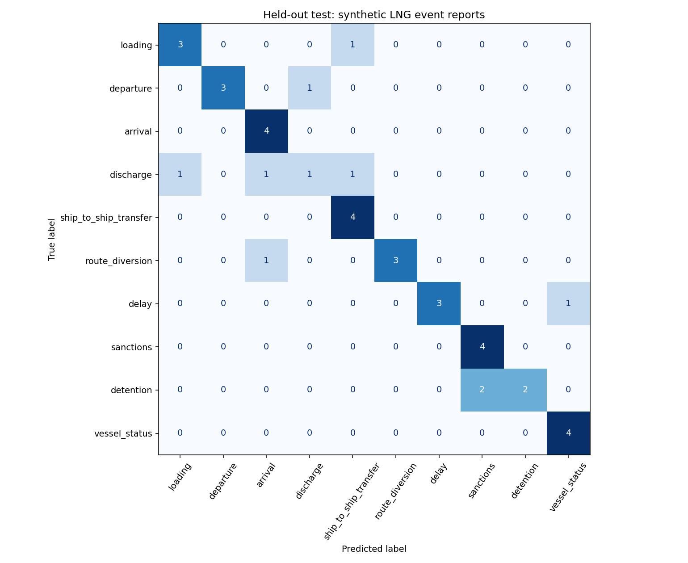

# LNG Event Classifier — Reproducible NLP Baseline

[](https://github.com/kirnat1992-lab/lng-event-classifier/actions/workflows/ci.yml) [](https://www.python.org/) [](LICENSE)

A small, reproducible **machine-learning demonstration** that classifies short LNG shipping-event descriptions into 10 categories. Built as a first AI/ML portfolio project at the intersection of **NLP, energy economics, shipping intelligence, and research reproducibility**.

> **Research integrity:** Every example in the dataset is **fictional/synthetic**. The scores below come from a small handcrafted test set and **do not establish accuracy on real Arctic LNG shipping reports**. A model prediction is never proof that a vessel movement or sanctions action occurred.

## What it does

1. Validates a labeled CSV and a predefined train/test split.
2. Trains a transparent **TF-IDF (word unigrams + bigrams) + logistic regression** classifier using scikit-learn.
3. Evaluates on 40 withheld synthetic examples with per-label precision/recall/F1, a confusion matrix, and prediction records.
4. Exposes a command-line interface for a single prediction.
5. Runs repeatability, validation, and end-to-end tests with `pytest`; CI config is included.

## Results (synthetic demonstration only)

| Metric | Held-out *synthetic* set |
| --- | ---: |
| Training examples | 80 |
| Test examples | 40 |
| Event categories | 10 |
| Accuracy | 0.775 |
| Macro-precision | 0.805 |
| Macro-recall | 0.775 |
| Macro-F1 | **0.761** |

The model is a baseline, not a production system. Its predictions have uncalibrated probability scores, and it does not abstain on unknown texts. See [`reports/metrics.json`](reports/metrics.json), [`reports/test_predictions.csv`](reports/test_predictions.csv), and the confusion matrix below.



### Error analysis (mistakes on synthetic test set)

Examples of mistakes in the **synthetic** test set reveal why this is a research baseline, not an evidence-verification tool:

| Example | True label | Predicted | Likely reason |
| --- | --- | --- | --- |
| Shore-to-tanker cargo transfer | `loading` | `ship_to_ship_transfer` | Shared verb “transferred” |
| “Unloading … after … berthed” | `discharge` | `arrival` | Arrival context distracts from unloading |
| Course change toward a discharge location | `route_diversion` | `arrival` | Destination/arrival vocabulary overlaps |
| Weather disrupted offshore wait | `delay` | `vessel_status` | “Offshore” and “waiting” also mark status reports |
| Port detention order | `detention` | `sanctions` | Legal enforcement terms overlap |

These are directly extracted from `reports/test_predictions.csv`; inspect that file for every prediction and score.

## Quick start

Requirements: Python **3.10+**. No API keys, paid services, web access, or GPU required.

```bash
git clone https://github.com/kirnat1992-lab/lng-event-classifier.git
cd lng-event-classifier
python -m venv .venv
# macOS/Linux: source .venv/bin/activate
# Windows PowerShell: .venv\Scripts\Activate.ps1
python -m pip install -r requirements-dev.txt
python -m pytest -q
python -m lng_event_classifier.train
```

Or, from the downloaded source ZIP, extract it and run the same commands **without** the `git clone` step. The training script writes a local model under `artifacts/` (ignored by Git) and refreshes the evaluation files under `reports/`.

Run an example prediction after training:

```bash
python -m lng_event_classifier.predict --text "The carrier began unloading LNG into shore tanks at the import terminal."
```

Example response (scores may vary slightly with dependency versions):

```json
{
  "label": "discharge",
  "model_probability": 0.1952,
  "note": "Uncalibrated model score; not a verification or evidence confidence rating."
}
```

### Docker (optional)

```bash
docker build -t lng-event-classifier .
docker run --rm lng-event-classifier
```

The Docker container runs training and writes outputs **inside** the container; mounting a host output directory is needed to retain them. Docker is optional and not required to reproduce the baseline.

## Repository structure

```text
lng-event-classifier/
├── .github/workflows/ci.yml        # tests and a fresh training run on push/PR
├── data/synthetic_events.csv      # 120 fictional labeled reports
├── docs/data-dictionary.md        # schema, label guide, leakage considerations
├── lng_event_classifier/
│   ├── data.py                    # input and split validation
│   ├── labels.py                  # ten-category taxonomy
│   ├── model.py                   # TF-IDF + logistic regression baseline
│   ├── train.py                   # CLI for training and metrics
│   └── predict.py                 # inference CLI
├── reports/                       # synthetic benchmark reports
├── tests/                         # five automated tests
├── Dockerfile                     # optional reproducibility container
├── LICENSE, .gitignore, pyproject.toml
└── requirements.txt, requirements-dev.txt
```

## Important limitations / next research stage

- The **synthetic vocabulary is much simpler** than real multilingual LNG reports, and manually authored train/test texts can be linguistically similar. Scores do not demonstrate external validity.
- Current classification assumes **exactly one of ten event types** and forces a label even when text is unrelated or ambiguous.
- A real evidence tracker needs **source URLs, timestamps, vessel identifiers, manual review, and separate event verification**. Those are **not** inferred by this model.
- Model probabilities are **not calibrated** and must not be interpreted as confidence that an event actually happened.
- Before using real reports: obtain rights to reuse text, develop an annotation rubric, independently label a gold set, group syndicated duplicates, reserve a chronological holdout, analyze rare classes, and test abstention/calibration.
- Never load `joblib` files from untrusted sources because loading uses Python pickle internally.

## Roadmap

- [x] Version 0.1: transparent synthetic dataset, ten-label baseline, evaluation, tests, CI configuration
- [ ] Version 0.2: independently sourced and licensed small real-world gold set with URL provenance
- [ ] Version 0.3: temporal/grouped evaluation, unknown-class handling, model calibration
- [ ] Version 0.4: connect manually reviewed output to the separate Arctic LNG Evidence Tracker

## About

Portfolio research prototype by **Natalia Kirsanova**, PhD candidate at Central European University, working on LNG markets, energy security, and computational research methods.

**License:** MIT for the code and original synthetic examples. All dataset records in this demonstration are fictional and created specifically for this project.
